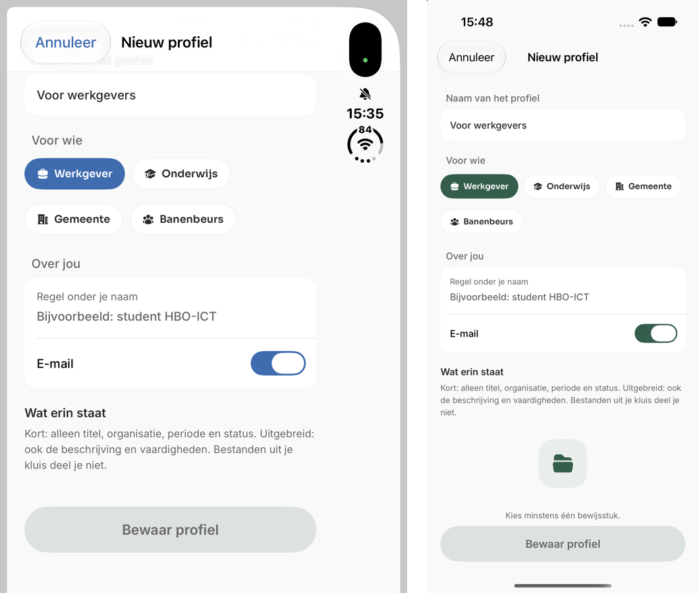
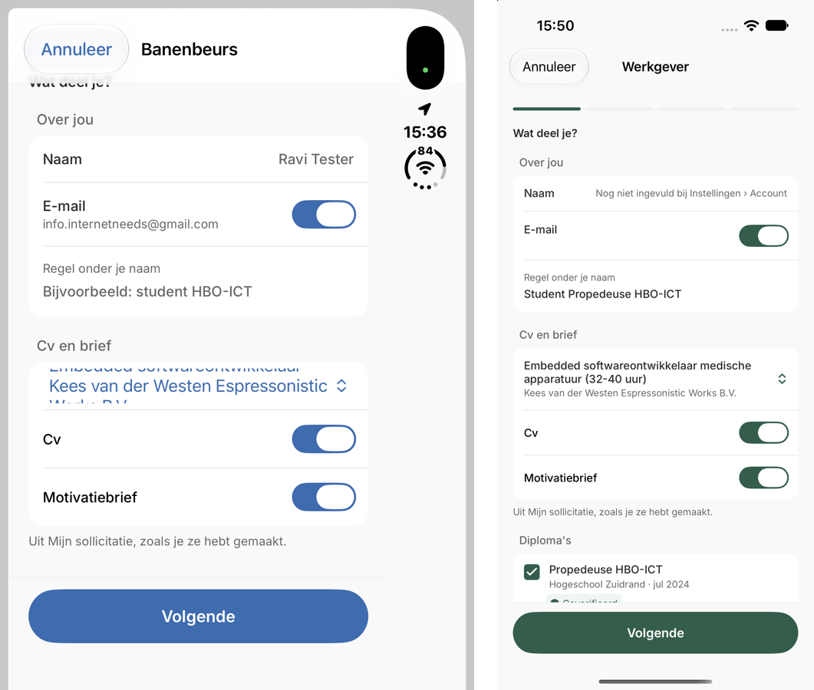
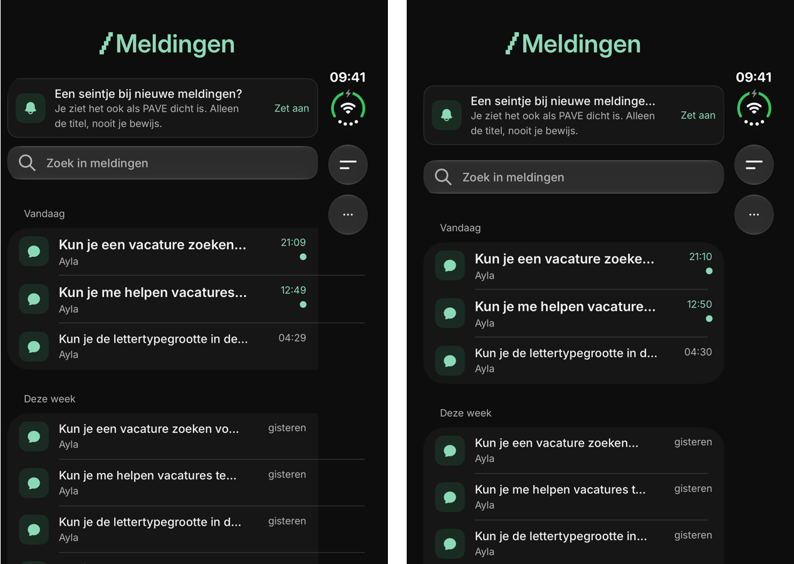
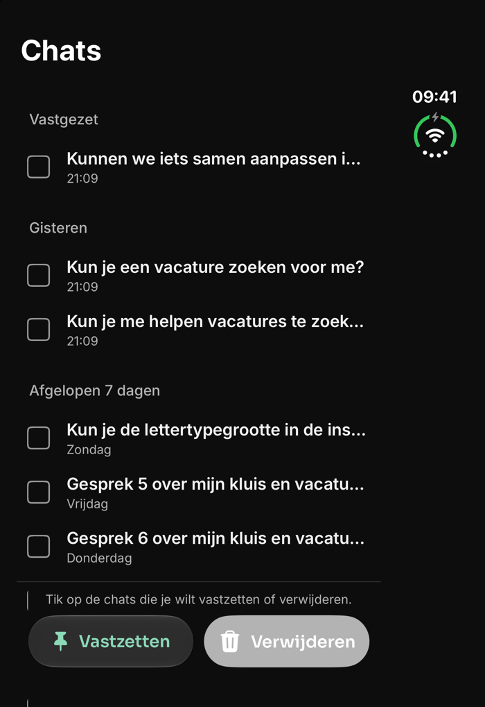
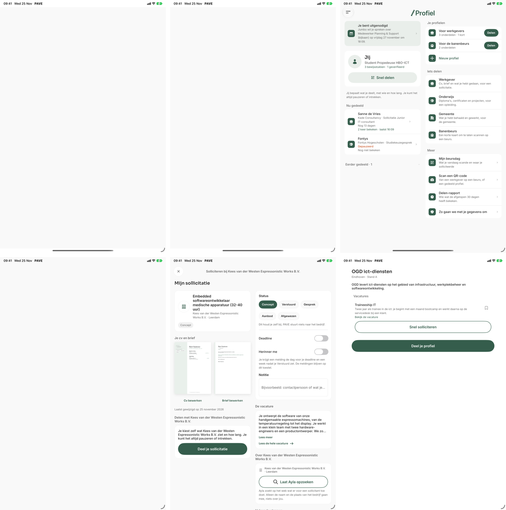
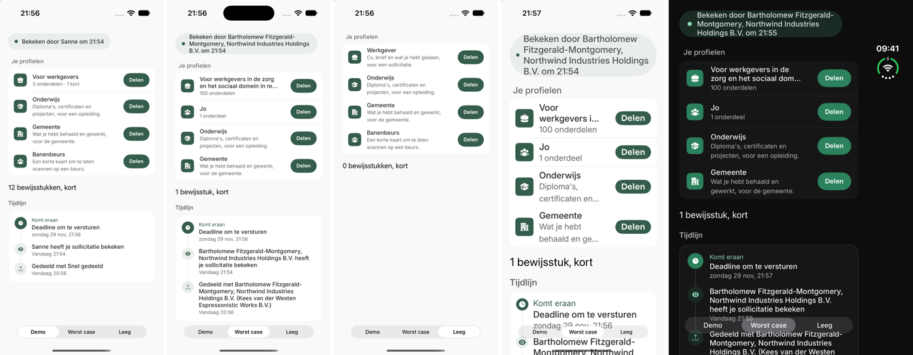
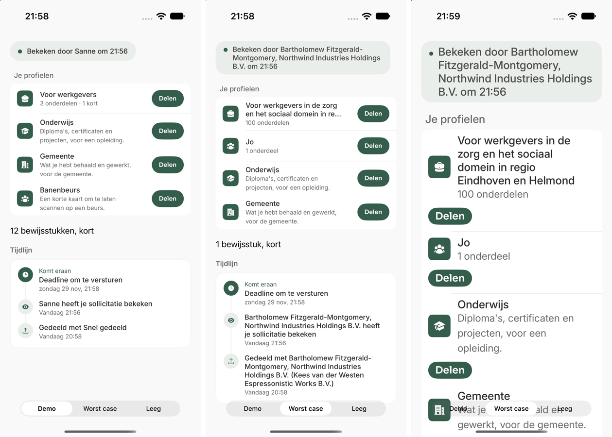

# Testen van PAVE (iOS)

Hoe we de iOS-app van PAVE testen, wat eruit kwam, wat we verbeterden en wat dat opleverde. We volgen de opbouw uit "Testen van je product" (Fontys): testen op drie manieren, trianguleren, en per ronde **resultaat → verbetering → effect**.

## Inhoud
- [Drie manieren van testen](#drie-manieren-van-testen)
- [Customer journey en user stories](#customer-journey-en-user-stories)
- [Ronde 1: gebruikerstest inloggen (6 november)](#ronde-1-gebruikerstest-inloggen-6-november)
- [Ronde 2: nalopen en lastige gegevens (25 november)](#ronde-2-nalopen-en-lastige-gegevens-25-november)
- [Ronde 3: vertalingen (27 november)](#ronde-3-vertalingen-27-november)
- [Overzicht van de rondes](#overzicht-van-de-rondes)
- [Volgende ronde: gebruikerstest 2](#volgende-ronde-gebruikerstest-2)
- [Nog open](#nog-open)

## Drie manieren van testen

| Soort | Wat we doen | Wanneer | Vraag |
|---|---|---|---|
| **Tijdens de ontwikkeling** (Workshop) | Elke wijziging nalopen op een echte iPhone Duo (dicht en open) en in de simulator op iPhone, open Duo en iPad. Een tweede reviewer (mens of AI) leest de code mee. Pull requests met goedkeuring van een teamlid. | Na elke wijziging | Doet het wat we bedoelden? |
| **Automatisch** (Showroom) | Ruim 550 unit tests (Swift Testing) in `ios/PAVECore` en `ios/PAVETests`, waaronder een test die de inlogteksten van iOS naast die van web legt. Een stresstest met de lastigste realistische gegevens (`break-ui`). | Bij elke wijziging | Werkt het technisch correct? |
| **Met de doelgroep** (Lab) | Gebruikerstests met studenten: taken uitvoeren, hardop denken, tijd en succes meten. | Per sprint | Snapt, wil en kan de gebruiker het? |

We trianguleren door dezelfde vraag uit minstens twee van deze drie te halen. Voorbeeld: "lukt het om met de goede code in te loggen?" kwam uit de gebruikerstest (4 van 5 zochten in hun mail) én uit het nalopen (de uitleg stond in een blokje dat niemand las).

## Customer journey en user stories

De belangrijkste reis van Ravi (hbo-ICT, bijna klaar):

**inloggen → kluis vullen → vacature vinden → cv en brief maken → delen → uitnodiging → gesprek**

De acceptatiecriteria hieronder zijn ons testplan.

**1. Inloggen met tweestapsverificatie**
Als student wil ik veilig inloggen met de code uit mijn authenticator-app, zodat alleen ik bij mijn gegevens kan.
- Het scherm zegt duidelijk dat de code uit de app komt, niet uit de mail.
- Een foute code maakt het veld leeg en zet de cursor er weer in.
- Een geplakt wachtwoord werkt.

**2. Zelf een sollicitatie maken**
Als student wil ik ook solliciteren op een vacature die ik zelf vond, of een open sollicitatie doen, zodat ik niet afhankelijk ben van wat PAVE vindt.
- Alleen het bedrijf is verplicht. Een lege functie wordt een open sollicitatie.
- Daarna opent meteen het ontwerp van cv en brief.
- Een ongeldige link geeft een duidelijke melding.

**3. Snel delen**
Als student wil ik in één stap een QR-code of link van mijn profiel maken, zodat iemand bij een stand of gesprek me direct kan bekijken.
- Eén scherm, één knop ("Maak QR-code"), bevestigd met Face ID.
- Ik zie wanneer iemand kijkt, en ik kan direct stoppen.
- Met een lege kluis zegt de app wat ik eerst moet doen.

**4. Snel solliciteren op de banenbeurs**
Als scholier wil ik bij een stand mijn kaartje achterlaten voor een bijbaan, zonder cv, zodat ik binnen een minuut kan solliciteren.
- Scannen met de gewone camera opent PAVE.
- Naam en "waarom" (getypt of ingesproken) zijn genoeg.
- Een uitnodiging kan ik beantwoorden vanaf mijn iPhone én mijn Apple Watch.

**5. Bijhouden hoe het gaat**
Als student wil ik per sollicitatie zien wat er gebeurde en wat eraan komt, zodat ik weet waar ik sta.
- De tijdlijn laat zien: gedeeld, wie keek, uitnodiging, status, en wat eraan komt.
- De volgende stap staat ook op mijn Watch.

## Ronde 1: gebruikerstest inloggen (6 november)

**Opzet:** 5 testers, iOS en web, vijf taken: inloggen (TC-01), code invullen (TC-02), pincode kiezen (TC-03), wachtwoord vergeten (TC-04), Face ID aanzetten (TC-05). Bron: `Npulse_Sprint_2_usertest_1.xlsx`.

| Bron | Resultaat | Verbetering |
|---|---|---|
| Doelgroep | **4 van 5** zochten de code eerst in hun mail in plaats van in de authenticator-app | Titel "Open je authenticator-app", telefoon-icoon, "Je krijgt deze code niet per e-mail." |
| Doelgroep | 3 van 5 lazen "cijfer en symbool" als "cijfer óf symbool" (iOS en web) | Twee losse eisen, elk met een eigen vinkje |
| Doelgroep | 2 van 5: een geplakt wachtwoord werkte niet | Een meegeplakte enter valt weg |
| Doelgroep | "Niet nu" met een pijl leek op "terug" | Gewone tekstknop zonder pijl |
| Ontwikkeling | De uitleg stond er al, maar onder de knop. Niemand las hem. | Het scherm zelf maakt het duidelijk, niet meer tekst |

**Conclusie:** twee bronnen (de test en het nalopen) wijzen naar hetzelfde probleem: de plek van de code is niet duidelijk. Dat hebben we als eerste aangepakt. Het effect meten we in gebruikerstest 2.

## Ronde 2: nalopen en lastige gegevens (25 november)

Na de banenbeurs, het delen en de sollicitaties hebben we alles nagelopen op drie manieren.

### Tijdens de ontwikkeling: op de echte Duo

Daaf vond op zijn iPhone Duo fouten die in de simulator niet opvielen.

| Resultaat | Verbetering | Bewijs |
|---|---|---|
| "Nieuw profiel" deed niets: knop grijs, niets om te kiezen. De kluis was niet geladen. | Profiel laadt de kluis zelf. Een lege kluis zegt dat, met een knop. Onder een grijze knop staat waarom. |  |
| Lange bedrijfsnaam in de keuzelijst bij delen afgesneden | Functie en bedrijf elk op een eigen regel |  |
| Meldingen op de dichte Duo: panelen liepen onder de zijbalk door, rechts afgekapt | Panelen blijven naast de zijbalk, titels mogen twee regels |  |
| Chats selecteren: ook kopjes en projecten kregen een rondje, knoppen half doorzichtig over de lijst | Alleen chats krijgen een vinkje; de knoppen staan op een vaste balk |  |
| Op de open Duo en iPad bleef de helft van het scherm leeg | Twee kolommen waar ruimte is, één op de telefoon |  |

### Ontwikkeling: code review

Een tweede reviewer las alle code van de nieuwe functies na en vond **24 punten**. De belangrijkste:
- Fouten bij delen werden niet getoond (de knop stopte gewoon met laden).
- Een tik op een melding bracht je nergens heen.
- Solliciteren vanuit Vacatures gooide je in de chat.
- Lange namen werden op zes plekken afgekapt.

Alle punten die geen keuze van het team vroegen, zijn verwerkt.

### Automatisch: lastige gegevens (`break-ui`)

We gaven de schermen de lastigste realistische gegevens, tot de grens van de database:
- een profielnaam van 80 tekens;
- een kijker met de naam "Bartholomew Fitzgerald-Montgomery, Northwind Industries Holdings B.V.";
- 100 onderdelen in een profiel;
- een lege kluis;
- grote letters.

We testten op de iPhone, de dichte Duo en met grote tekst (Dynamic Type).

| Ernst | Resultaat | Verbetering |
|---|---|---|
| Kapot | Bij grote letters bleef van een profielnaam alleen "Voor werkgevers i…" over | Bij grote tekst staat de knop Delen onder de tekst |
| Lelijk | Een lange naam bij "Bekeken door" rekte de capsule op tot drie regels | Een rustige afgeronde kaart, die bij één regel hetzelfde blijft |
| Kwetsbaar | Geen maximale lengte voor je volledige naam gevonden | Afstemmen met het web-team (gedeelde tabel) |

**Hield stand:**
- de tijdlijn met lange namen;
- een lege lijst met profielen;
- de tellers: "1 bewijsstuk", "0 bewijsstukken", "100 onderdelen";
- de dichte Duo.

**Conclusie:** drie bronnen (Daaf op de echte Duo, de code review en de stresstest) wijzen naar hetzelfde: de schermen waren gebouwd met "vriendelijke" gegevens (korte namen, een volle kluis, een gewone iPhone). Sinds deze ronde testen we elk nieuw scherm met een lege kluis, met lange namen en op de dichte Duo, voordat we het laten zien.

## Ronde 3: vertalingen (27 november)

**Opzet:** PAVE is er in het Nederlands, Engels en Papiamentu (Instellingen › Taal). De teksten staan in het Nederlands in de code; `Localizable.xcstrings` vertaalt ze. `PAVETests/LocalizationTests` controleert dat bij elke wijziging:

| Test | Wat hij controleert |
|---|---|
| Elke tekst heeft elke taal | Engels en Papiamentu bestaan, zijn "translated" en niet leeg |
| Waarden en spaties blijven | Een vertaling heeft dezelfde `%@` als het Nederlands en dezelfde spatie vooraan of achteraan (" op %@") |
| Papiamentu is niet gekopieerd | Geen Papiamentu-tekst die gelijk is aan de Engelse |
| De app heeft elke taal | De gebouwde app bevat de Engelse en Papiamentse tabel met alle teksten |
| De vertaler vindt elke tekst | Elke tekst uit de catalogus, ingevuld met namen, komt eruit als zijn eigen vertaling |
| Data volgen de taal | "27 november" in het Nederlands en Papiamentu, "27 November" in het Engels |
| Elke tekst in de code is vertaald | Leest alle Swift-code, vult elke tekst in zoals hij op het scherm komt (ook elke keuze in `a ? "x" : "y"`) en kijkt of hij in het Engels uitkomt, ook in de stukjes |

**Resultaat en verbetering:**

| Wat we vonden | Wat we deden |
|---|---|
| De vertaler koos bij twee passende teksten de verkeerde: "Past bij Kade" werd "Past at Kade" (via "%@ bij %@") en "1 keer bekeken" werd "viewed 1 times". Hij koos de tekst met de langste regex, en dat is de tekst met de meeste waarden. | Hij kiest nu de tekst met de meeste eigen woorden (`TranslationTable`) |
| "2 van 5 afgerond" bleef half Nederlands ("2 of 5 afgerond") als er geen stappen waren overgeslagen | "%@ afgerond" toegevoegd |
| "Safari op iPhone", "Nu: …", "na …" en "Kade en Jumbo" bleven Nederlands. Een tekst met minder dan 3 eigen letters vult de vertaler bewust niet in, zodat "%@ · %@" niet op elke tekst past. | Deze plekken vertalen nu zelf met `PaveTranslator.format("%@ op %@", …)` |
| De tests die Nederlands verwachten (Plan, Ayla) faalden op een simulator in het Engels | Het schema test nu in het Nederlands (Nederland) |
| 10 teksten zonder vertaling: "Terug naar alle chats", "Gesprek verwijderen?", de uitleg bij verwijderen, "Dit account", "alleen bekijken", "mag downloaden", "de contactpersoon", "de organisatie", "Je deelt met …, 3 keer bekeken" | Engels en Papiamentu toegevoegd |

**Hield stand:** alle 2651 teksten hebben beide talen, geen enkele vertaling mist een waarde of spatie, en de app bevat beide tabellen.

**Nog open:** het Papiamentu is door AI vertaald en moet nog door iemand die de taal spreekt worden nagelezen (bijvoorbeeld "Mag baha", waar "Por baha" waarschijnlijk beter is).

## Overzicht van de rondes

| Ronde | Belangrijkste bevinding | Wat we verbeterden | Effect |
|---|---|---|---|
| 1 (6 nov) | 4 van 5 zochten de code in de mail | Titel, icoon en zin die zeggen dat de code uit de app komt | Meten in gebruikerstest 2 |
| 2 (25 nov) | Schermen braken met lege of lange gegevens en op de dichte Duo | Lege staten, uitleg bij grijze knoppen, teksten die meegroeien, twee kolommen op brede schermen | Alle gevonden breuken weg in de stresstest; Demo-gegevens zien er hetzelfde uit |
| 3 (27 nov) | De vertaler koos soms de verkeerde vertaling; 10 teksten zonder vertaling | Vertaler kiest de best passende tekst; ontbrekende vertalingen toegevoegd; `LocalizationTests` | Alle teksten in de code komen in het Engels uit |
| 4 | Gebruikerstest 2 | — | — |

## Volgende ronde: gebruikerstest 2

**Onderzoeksvraag:** kunnen studenten zonder uitleg solliciteren en hun profiel delen, ook op een banenbeurs?

**Opzet:** 5 testers uit de doelgroep (student of scholier), op een iPhone (bij voorkeur hun eigen telefoon) en één keer op de Duo. Hardop denken, tijd meten, na afloop vragen wat lastig was. Er staan echte QR-posters (Jumbo, OGD) op tafel.

| Taak | Gemeten | Geslaagd als |
|---|---|---|
| T1. Log in met je account. | Waar zoek je de code? Tijd | Code meteen in de authenticator-app gezocht (effect ronde 1) |
| T2. Je loopt langs de Jumbo-stand. Solliciteer op de bijbaan. | Tijd, aantal fouten | Binnen 1 minuut kaartje achtergelaten |
| T3. Een werkgever wil je profiel zien. Laat hem het scannen. | Tijd, wat de tester zegt | Snel delen gevonden en QR-code getoond, zonder hulp |
| T4. Je vond zelf een vacature bij Albert Heijn. Maak een cv en brief. | Tijd, waar de tester vastloopt | "Nieuwe sollicitatie" gevonden, cv gemaakt |
| T5. Hoe staat je sollicitatie bij Kade ervoor? | Wat de tester leest | Tijdlijn gevonden, "bekeken" begrepen |
| T6. Stop met delen. | Tijd | Binnen 3 tikken gestopt |

Na afloop vullen we het overzicht van de rondes aan met de cijfers (bijvoorbeeld "code in de goede app gezocht: 1/5 → x/5").

## Nog open
- **Toegankelijkheid:** VoiceOver op Profiel, Delen en de tijdlijn; de Accessibility Inspector van Xcode op de nieuwe schermen. Grote tekst is deels getest (ronde 2).
- **Echte Watch:** het kaartje en de volgende stap zijn op de iPhone getest, nog niet op een echte Apple Watch.
- **Twee toestellen op de beurs:** een volledige ronde met student en werkgever op twee toestellen.
- **Traag netwerk:** delen en de beurs met een trage verbinding (Network Link Conditioner).
- **iPad en de Duo dwars:** alleen in de simulator op iPad mini-formaat bekeken.
