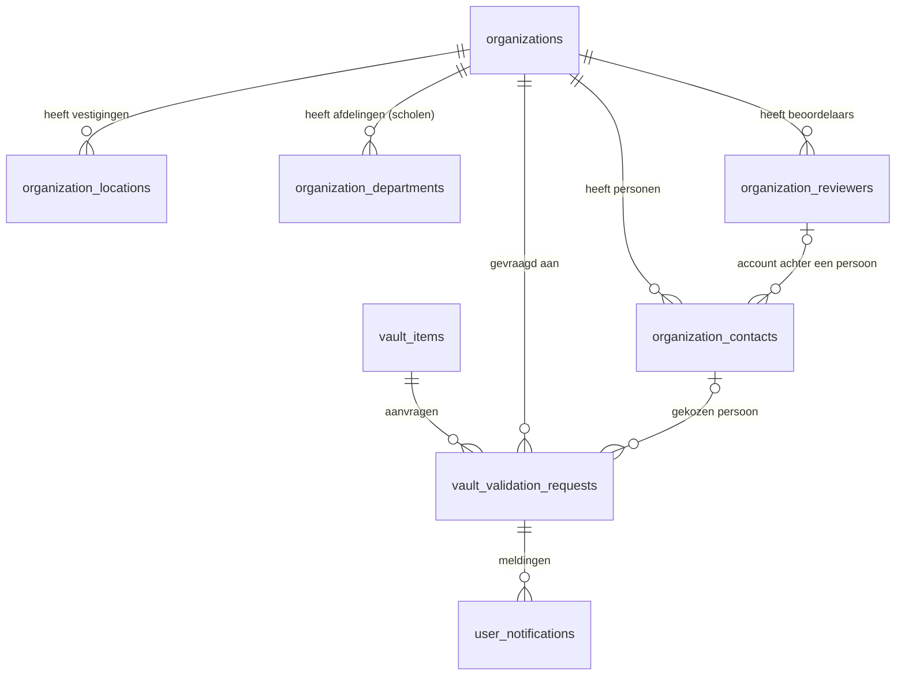

# Verificatie, organisaties en meldingen

Een lerende vraagt een organisatie om bewijs in de kluis te bevestigen. Iemand van die organisatie krijgt een melding, bekijkt het bewijs en verifieert of wijst af (met een reden). De lerende krijgt daarna een melding.

De hele database-opzet staat in één migratie: [`20261117180000_organisations_verification_notifications.sql`](../shared/supabase/migrations/20261117180000_organisations_verification_notifications.sql). Alles wat schrijft, loopt via de Edge Function [`vault-review`](../shared/supabase/functions/vault-review/index.ts).

## Opbouw

```
Organisatie            Fontys                         Coolblue
└─ Locatie             ├─ Fontys Tilburg              ├─ Coolblue Tilburg
   └─ Afdeling         │  ├─ ICT                      │  └─ contactpersoon (of meer)
      (alleen school)  │  │  └─ docenten              └─ Coolblue Breda
                       │  └─ Educatie                    └─ contactpersoon (of meer)
                       │     └─ docenten
                       └─ Fontys Eindhoven
                          └─ ICT  (een andere afdeling dan ICT in Tilburg, met eigen docenten)
                             └─ docenten
```

De lerende kiest eerst de organisatie, dan de locatie, dan (bij een school) de afdeling en dan één persoon.

## Tabellen



| Tabel | Wat erin staat | Wie leest | Wie schrijft |
| --- | --- | --- | --- |
| `organizations` | Organisaties (van het web-team). `kind` = `school` of `company`; zonder `kind` staat een organisatie niet in de keuzelijst. | Leden hun eigen; de keuzelijst via `validation_organizations()` | Web-team, SQL Editor |
| `organization_locations` | Vestigingen per organisatie (stad). | Iedereen met tweestapsverificatie | SQL Editor |
| `organization_departments` | Afdelingen of opleidingen van één schoollocatie (Fontys Tilburg ICT). Heeft een locatie afdelingen, dan kiest de lerende er een. | Iedereen met tweestapsverificatie | SQL Editor |
| `organization_contacts` | De personen die een lerende kan kiezen, met functie: bij een bedrijf aan een locatie, bij een school aan een afdeling. `reviewer_id` = het PAVE-account van die persoon (optioneel). | Iedereen met tweestapsverificatie, **behalve** `reviewer_id` | SQL Editor |
| `organization_reviewers` | Reservebeoordelaars per organisatie (bijv. het stagebureau): zij handelen aanvragen af voor personen zonder PAVE-account. | Alleen je eigen toewijzingen | SQL Editor |
| `vault_validation_requests` | Eén rij per aanvraag: bewijs, organisatie, vestiging, persoon, bericht, status, wie besliste, wanneer en waarom. | De lerende zijn eigen | Alleen `vault-review` |
| `user_notifications` | De meldingen per account: Ayla-antwoorden, aanvragen voor beoordelaars, beslissingen voor lerenden. | Je eigen (als gelezen markeren, verwijderen en binnen 7 dagen terugzetten) | Alleen de server |

Elke tabel heeft naast de leesregel een aparte regel "Require two-step verification", net als de kluistabellen.

## Hoe een aanvraag loopt

1. **Aanvragen** (iOS → `vault-review`, actie `create`): de lerende kiest organisatie, locatie, bij een school de afdeling, en één persoon. De functie controleert of de afdeling bij die locatie hoort en de persoon bij precies die locatie en afdeling en of het bewijs van de lerende is en "Niet bevestigd" of "Afgewezen" is. Dan maakt hij de aanvraag aan en een melding voor elke ontvanger. Afgewezen bewijs gaat terug naar "Niet bevestigd".
2. **Ontvangers** (`vault_validation_recipients`): het account van de gekozen persoon (`organization_contacts.reviewer_id`). Heeft die persoon geen account, dan alle beoordelaars van de organisatie. **De aanvrager zelf is nooit ontvanger**, ook niet als die beoordelaar is. Zijn er geen ontvangers, dan weigert de functie de aanvraag (`no_reviewers`).
3. **Beoordelen** (`detail`): de ontvanger ziet het bewijs en opent de bestanden via links die vijf minuten geldig zijn.
4. **Beslissen** (`resolve` → `resolve_vault_validation_request`): in één transactie worden de aanvraag, de status van het bewijs en de melding voor de lerende bijgewerkt. Afwijzen kan alleen met een reden.
5. **Melding voor de lerende** (`inbox`): de lerende ziet "Bewijs geverifieerd" of "Bewijs afgewezen" met de titel van het bewijs en de organisatie. Ook wie zelf beoordelaar is, ziet de beslissingen over het eigen bewijs. De melding blijft staan als geschiedenis, ook als het bewijs daarna wordt aangepast of opnieuw wordt aangevraagd.
5. **Lerende**: krijgt "Bewijs geverifieerd" of "Bewijs afgewezen". In de kluis staat de status en, na een afwijzing, de reden met "Opnieuw bevestiging aanvragen". Zolang een aanvraag loopt, staat er "In afwachting".

## Beoordelaars beheren

Dit doe je in de SQL Editor van Supabase. Een beoordelaar moet tweestapsverificatie hebben ingesteld.

```sql
-- Iemand mag aanvragen van een organisatie beoordelen
insert into public.organization_reviewers (organization_id, reviewer_id)
select o.id, u.id
from public.organizations o, auth.users u
where o.name = 'Fontys Hogeschool' and u.email = 'beoordelaar@voorbeeld.nl'
on conflict do nothing;

-- Een persoon uit de lijst koppelen aan dat account; aanvragen aan die persoon gaan dan alleen naar dit account.
-- (Het account moet eerst beoordelaar van de organisatie zijn, zie hierboven.)
update public.organization_contacts c
set reviewer_id = u.id
from public.organizations o, public.organization_locations l, auth.users u
where c.organization_id = o.id and c.location_id = l.id
  and o.name = 'Fontys Hogeschool' and l.city = 'Tilburg'
  and c.name = 'Sanne de Vries'
  and u.email = 'beoordelaar@voorbeeld.nl';

-- Een echte persoon toevoegen: bij een bedrijf aan een locatie, bij een school aan een afdeling van die locatie
insert into public.organization_contacts (organization_id, location_id, department_id, name, job_title)
select l.organization_id, l.id, d.id, 'Voornaam Achternaam', 'Docent'
from public.organization_locations l
join public.organizations o on o.id = l.organization_id
left join public.organization_departments d on d.location_id = l.id and d.name = 'ICT'   -- weglaten bij een bedrijf
where o.name = 'Fontys Hogeschool' and l.city = 'Tilburg';

-- Wie mag wat beoordelen?
select o.name as organisatie, u.email as beoordelaar,
       (select string_agg(c.name, ', ') from public.organization_contacts c
        where c.organization_id = o.id and c.reviewer_id = u.id) as gekoppeld_aan
from public.organization_reviewers r
join public.organizations o on o.id = r.organization_id
join auth.users u on u.id = r.reviewer_id
order by 1, 2;

-- Weghalen (de koppeling aan een persoon verdwijnt dan vanzelf)
delete from public.organization_reviewers r
using public.organizations o, auth.users u
where r.organization_id = o.id and r.reviewer_id = u.id
  and o.name = 'Fontys Hogeschool' and u.email = 'beoordelaar@voorbeeld.nl';
```

Een account met minstens één toewijzing krijgt in de app de beoordelaarsweergave (verificatieaanvragen en gesprekken). Test daarom met twee accounts: een lerende zonder toewijzing en een beoordelaar.

## Demogegevens

De migratie vult de keuzelijst met 37 organisaties in Brabant en hun locaties. Elke schoollocatie krijgt drie afdelingen met elk twee verzonnen docenten, elke bedrijfslocatie één verzonnen contactpersoon. Alleen lege afdelingen en locaties krijgen demo-personen, dus echte personen komen er nooit naast te staan. Dat zijn geen echte medewerkers. Echte personen voegt het team toe in `organization_contacts`; aanvragen aan een demo-persoon gaan naar de beoordelaars van de organisatie.

## Afspraken

- Alleen `vault-review` (met de service-role-sleutel) maakt en beslist aanvragen. De app en het web schrijven nooit rechtstreeks in `vault_validation_requests`.
- Wie een aanvraag ontvangt, komt altijd uit de database (`vault_validation_recipients`), nooit uit wat de app meestuurt.
- Wie achter een persoon zit (`reviewer_id`) en wie beoordelaar is, ziet een lerende nooit.
- Meldingen bevatten alleen weergavetekst en ID's: geen bewijs, bestanden of chattekst.
- Verwijderen is zacht (`deleted_at`): de melding staat 7 dagen onder "Recent verwijderd" en is terug te zetten. De database zet zelf de tijd (`guard_user_notification_update`), dus de app kan de termijn niet oprekken. Daarna verwijdert `vault-review` hem bij het laden van de inbox, en 's nachts `purge_deleted_notifications()` (alleen als pg_cron aanstaat).
- Wijzig je deze opzet, pas dan de migratie, deze pagina en `ios/README.md` samen aan.
