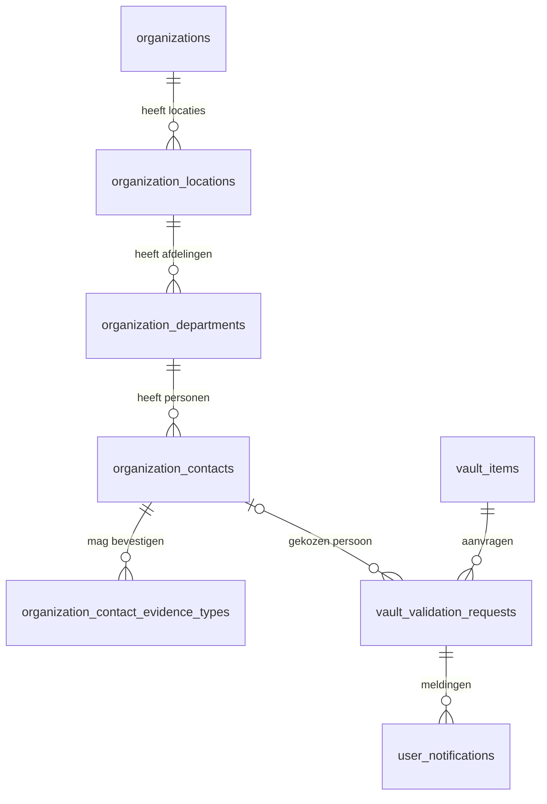

# Verificatie, organisaties en meldingen

Een lerende vraagt een organisatie om bewijs in de kluis te bevestigen. Iemand van die organisatie krijgt een melding, bekijkt het bewijs en verifieert of wijst af (met een reden). De lerende krijgt daarna een melding.

Alles wat schrijft, loopt via de Edge Function [`vault-review`](../shared/supabase/functions/vault-review/index.ts).

## Opbouw

```
Organisatie            Fontys                         Coolblue
└─ Locatie             ├─ Fontys Tilburg              └─ Coolblue Breda
   └─ Afdeling         │  ├─ ICT                         ├─ Stage
      └─ Persoon       │  │  └─ docenten                 │  └─ stagebegeleider
                       │  └─ Educatie                    └─ HR
                       │     └─ docenten                    └─ contactpersoon
                       └─ Fontys Eindhoven
                          └─ ICT  (een andere afdeling dan ICT in Tilburg, met eigen docenten)
```

De lerende kiest een organisatie en dan één persoon; vestiging, afdeling en functie zijn alleen zoekfilters. Dat is bij onderwijs, bedrijven, overheid en overige instellingen hetzelfde. De organisatie wordt ingevuld als het bewijs of een eerdere aanvraag haar ID heeft; een getypte naam is alleen een suggestie. Een persoon is altijd gekoppeld aan een PAVE-account: dat account krijgt de aanvraag en beslist. Er is geen aparte lijst met beoordelaars.

Een account is niet genoeg: een persoon mag alleen de soorten bewijs bevestigen die in `organization_contact_evidence_types` staan. Alleen die personen zijn te vinden en te kiezen.

De database: [`20261117180000_organisations_verification_notifications.sql`](../shared/supabase/migrations/20261117180000_organisations_verification_notifications.sql), vereenvoudigd door [`20261120180000_simple_verification_directory.sql`](../shared/supabase/migrations/20261120180000_simple_verification_directory.sql) en landelijk gemaakt door [`20261124120000_national_verification_directory.sql`](../shared/supabase/migrations/20261124120000_national_verification_directory.sql).

## Tabellen



| Tabel | Wat erin staat | Wie leest | Wie schrijft |
| --- | --- | --- | --- |
| `organizations` | Organisaties (van het web-team). `kind` = `school`, `company`, `government` of `other`; zonder `kind` staat een organisatie niet in de keuzelijst. `registry_type` + `registry_id` = KvK-, BRIN- of OIN-nummer, uniek per register. | Leden hun eigen; zoeken via `validation_search_organizations()` | Web-team, SQL Editor |
| `organization_locations` | Locaties per organisatie (stad). | Iedereen met tweestapsverificatie | SQL Editor |
| `organization_departments` | Afdelingen van één locatie: opleidingen bij een school (Fontys Tilburg ICT), Stage en HR bij een bedrijf. | Iedereen met tweestapsverificatie | SQL Editor |
| `organization_contacts` | De personen in een afdeling, met functie. `reviewer_id` = het PAVE-account van die persoon. | Iedereen met tweestapsverificatie, alleen actieve personen **met** een account, nooit jezelf. `reviewer_id` zelf is niet leesbaar. | SQL Editor |
| `organization_contact_evidence_types` | Per persoon de soorten bewijs (`vault_items.category`) die hij of zij mag bevestigen. Een nieuwe persoon krijgt automatisch de standaardset van zijn soort organisatie. Personen van vóór 24-11-2026 kregen eenmalig alle soorten. | Niemand in de app; alleen de functies hieronder | SQL Editor |
| `organization_kind_evidence_types` | De standaardset per soort organisatie (onderwijs, bedrijf, overheid, overig). Wijzigen geldt alleen voor personen die je daarna toevoegt. | Niemand in de app | SQL Editor |
| `vault_validation_requests` | Eén rij per aanvraag: bewijs, organisatie, locatie, afdeling, persoon, bericht, status, wie besliste, wanneer en waarom. | De lerende zijn eigen | Alleen `vault-review` |
| `user_notifications` | De meldingen per account: Ayla-antwoorden, aanvragen voor beoordelaars, beslissingen voor lerenden. | Je eigen (als gelezen markeren, verwijderen en binnen 7 dagen terugzetten) | Alleen de server |

Elke tabel heeft naast de leesregel een aparte regel "Require two-step verification", net als de kluistabellen.

De app zoekt in de database, per pagina van 25 (hooguit 50), met tweestapsverificatie. Alle functies tonen alleen personen die actief zijn, een account hebben, niet de lerende zelf zijn en dit soort bewijs mogen bevestigen:

| Functie | Wat |
| --- | --- |
| `validation_search_organizations(categorie, zoekterm, soort, limit, offset)` | Organisaties met minstens één zo'n persoon, met hun steden. |
| `validation_organizations_by_id(categorie, ids)` | De organisatie van het bewijs of van een eerdere aanvraag. |
| `validation_search_contacts(organisatie, categorie, zoekterm, vestiging, afdeling, functie, limit, offset)` | Personen, gezocht op naam, functie, afdeling en stad. |
| `validation_contact_filters(organisatie, categorie)` | De vestigingen, afdelingen en functies om op te filteren. |
| `validation_previous_contacts(categorie, limit)` | Wie de lerende eerder vroeg en het nog mag bevestigen. |

## Hoe een aanvraag loopt

1. **Aanvragen** (iOS → `vault-review`, actie `create`): de lerende kiest een organisatie en één persoon. De functie zoekt zelf afdeling en vestiging van die persoon op en controleert of die bij de organisatie horen, of de persoon actief is, een account heeft, niet de lerende zelf is en dit soort bewijs mag bevestigen (anders `not_authorized`), en of het bewijs van de lerende is en "Niet bevestigd" of "Afgewezen" is. Dan maakt hij de aanvraag aan en een melding voor het account van de persoon. Afgewezen bewijs gaat terug naar "Niet bevestigd".
2. **Ontvanger** (`vault_validation_recipients`): het account van de gekozen persoon, zolang die dit soort bewijs mag bevestigen, en nooit de lerende die de aanvraag deed. Neem je het recht af, dan verdwijnen ook de open aanvragen uit die inbox.
3. **Beoordelen** (`detail`): de ontvanger ziet het bewijs en opent de bestanden via links die vijf minuten geldig zijn.
4. **Beslissen** (`resolve` → `resolve_vault_validation_request`): in één transactie worden de aanvraag, de status van het bewijs en de melding voor de lerende bijgewerkt. Afwijzen kan alleen met een reden.
5. **Melding voor de lerende** (`inbox`): de lerende ziet "Bewijs geverifieerd" of "Bewijs afgewezen" met de titel van het bewijs en de organisatie. Ook wie zelf beoordelaar is, ziet de beslissingen over het eigen bewijs. De melding blijft staan als geschiedenis, ook als het bewijs daarna wordt aangepast of opnieuw wordt aangevraagd.
6. **Lerende**: krijgt "Bewijs geverifieerd" of "Bewijs afgewezen". In de kluis staat de status en, na een afwijzing, de reden met "Opnieuw bevestiging aanvragen". Zolang een aanvraag loopt, staat er "In afwachting".

## Lerende en beoordelaar

Er is geen rol "beoordelaar" in `profiles`. Een account is beoordelaar zodra het als `reviewer_id` aan minstens één persoon in `organization_contacts` gekoppeld is. Dan stuurt `vault-review` bij de meldingen `audience: administrator` mee en toont de app de beoordelaarsweergave. Anders is het een lerende. Eén account kan beide zijn: dan beoordeelt het aanvragen en vraagt het zelf ook verificatie aan, maar nooit bij zichzelf.

`profiles.role` (`learner` of `admin`) is van het web-team en staat hier los van: de apps lezen die kolom niet, en `admin` maakt je geen beoordelaar.

## Personen beheren

Dit doe je in de SQL Editor van Supabase. Het account moet tweestapsverificatie hebben ingesteld.

```sql
-- Een persoon toevoegen, met het PAVE-account dat de aanvragen krijgt
insert into public.organization_contacts (department_id, name, job_title, reviewer_id)
select d.id, 'Voornaam Achternaam', 'Docent', u.id
from public.organizations o
join public.organization_locations l on l.organization_id = o.id
join public.organization_departments d on d.location_id = l.id
join auth.users u on u.email = 'beoordelaar@voorbeeld.nl'
where o.name = 'Fontys Hogeschool' and l.city = 'Tilburg' and d.name = 'ICT';

-- Een nieuwe persoon krijgt vanzelf de standaardset van de soort organisatie (zie organization_kind_evidence_types).
-- Alleen voor uitzonderingen pas je hieronder iets aan.

-- Wat mag deze persoon (extra) bevestigen? Zonder rij hier is iemand niet te kiezen.
-- Soorten: diplomas, certificates, badges, projects, workExperience, internships, skills, feedback, reflections, other
insert into public.organization_contact_evidence_types (contact_id, category)
select c.id, k.category
from public.organization_contacts c
cross join (values ('internships'), ('workExperience')) as k (category)
where c.name = 'Voornaam Achternaam'
on conflict do nothing;

-- Een recht afnemen
delete from public.organization_contact_evidence_types
where contact_id = (select id from public.organization_contacts where name = 'Voornaam Achternaam') and category = 'diplomas';

-- Een afdeling toevoegen
insert into public.organization_departments (location_id, name)
select l.id, 'Marketing'
from public.organizations o
join public.organization_locations l on l.organization_id = o.id
where o.name = 'Coolblue' and l.city = 'Breda';

-- Wie zit waar, en met welk account?
select o.name as organisatie, l.city as locatie, d.name as afdeling, c.name as persoon, c.job_title as functie,
       u.email as account, c.is_active as actief
from public.organization_contacts c
join public.organization_departments d on d.id = c.department_id
join public.organization_locations l on l.id = d.location_id
join public.organizations o on o.id = l.organization_id
left join auth.users u on u.id = c.reviewer_id
order by 1, 2, 3, 4;

-- Iemand tijdelijk uit de keuzelijst halen (open aanvragen kan die persoon nog beoordelen)
update public.organization_contacts set is_active = false where name = 'Voornaam Achternaam';
```

Een account dat aan minstens één persoon gekoppeld is, krijgt in de app de beoordelaarsweergave (verificatieaanvragen en gesprekken). Test daarom met twee accounts: een lerende en een account dat aan een persoon gekoppeld is. Een persoon zonder account zie je niet in de app.

## Gegevens in de keuzelijst

De migratie vult de keuzelijst met 37 organisaties in Brabant en hun locaties. Elke schoollocatie krijgt drie afdelingen, elke bedrijfslocatie de afdelingen Stage en HR. Er staan geen verzonnen personen in: het team voegt personen toe met hun account (zie hierboven).

## Afspraken

- Alleen `vault-review` (met de service-role-sleutel) maakt en beslist aanvragen. De app en het web schrijven nooit rechtstreeks in `vault_validation_requests`.
- Wie een aanvraag ontvangt, komt altijd uit de database (`vault_validation_recipients`), nooit uit wat de app meestuurt.
- Welk account achter een persoon zit (`reviewer_id`) en wie wat mag bevestigen, ziet een lerende nooit.
- Een nieuwe persoon krijgt de standaardset van de soort organisatie; uitzonderingen per persoon staan in `organization_contact_evidence_types`. Een organisatie zonder `kind` geeft geen standaardset.
- Meldingen bevatten alleen weergavetekst en ID's: geen bewijs, bestanden of chattekst.
- Verwijderen is zacht (`deleted_at`): de melding staat 7 dagen onder "Recent verwijderd" en is terug te zetten. De database zet zelf de tijd (`guard_user_notification_update`), dus de app kan de termijn niet oprekken. Daarna verwijdert `vault-review` hem bij het laden van de inbox, en 's nachts `purge_deleted_notifications()` (alleen als pg_cron aanstaat).
- Wijzig je deze opzet, pas dan de migratie, deze pagina en `ios/README.md` samen aan.
